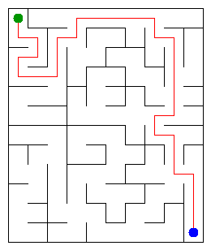

# Assignment 3. Maze Escape

Student ID: 254522  
Name: Arnur Sadyrov  
Group: SE-2532  
Maze size (rows x columns): 12 x 10

This file is the report. How to start: `START_HERE.md`. The task: `docs/Assignment3.pdf`.

## Program output

The 13 lines printed by `java -cp out Main` on my data:

    Broken: 119
    Kept: 99
    Last broken wall: 167
    MST cost: 33722
    Heaviest broken wall: 864
    Path length: 30
    DFS visited: 40
    Dead ends: 32
    Zones: 8
    Largest zone: 26
    Is DAG: 0
    Flow stages: 8
    Fastest route cost: 13

My maze:

## Questions

### Mission 0
`find` returns the representative (root) of the set containing a cell, while `union` joins two different sets and returns false if they are already connected. Path compression shortens paths during `find`, and union by size attaches the smaller tree under the larger one, so the operations are very fast in practice.

### Mission 1
There are `R*C` cells, and the broken walls form a connected graph with no cycles, so they form a tree. A tree with `R*C` vertices has exactly `R*C - 1` edges, so Broken is always `R*C - 1`; subtracting this from the total number of inner walls gives `(R-1)*(C-1)` walls that stay.

### Mission 2
Kruskal MST cost: **33722**. Prim MST cost: **33722**. They are equal because both algorithms build a minimum spanning tree of the same connected weighted graph, although they choose the edges in different ways.

### Mission 3
There is exactly one path between any two cells because the maze from Mission 1 is a tree: it is connected and contains no cycles. I used an explicit stack instead of recursive DFS, so a very large maze does not depend on the limited Java call stack and does not cause a stack overflow.

### Mission 4
The second pass of Kosaraju uses the reversed graph so that, when vertices are processed in decreasing finish order, the DFS stays inside one strongly connected component instead of following edges into a later component. Since the input has no self-slides, the slide graph has no directed cycle exactly when every strongly connected component has one cell, which means `Zones` equals the number of cells.

### Mission 5
The zone numbers produced by the second Kosaraju pass are a topological order, so every edge between different zones goes from a smaller number to a larger number. Therefore, when the zones are processed in numeric order, all information from predecessor zones is already known; the pass takes `O(z + e)` time, which is at most `O(n + m)`.

## AI use

ChatGPT was used to explain the DSU, MST, iterative DFS, Kosaraju and DAG ideas, and to review the implementation and testing. The final program was checked with the provided `Check.java` examples.

## Timing (Mission 7)

Milliseconds, 5 runs each, from `java -cp out Bench`:

| maze | Kruskal | Prim |
|---|---:|---:|
| 100 x 100 | 8 ms | 10 ms |
| 300 x 300 | 17 ms | 73 ms |
| 1000 x 1000 | 302 ms | 2374 ms |

The running time increases as the number of cells and walls grows. Both algorithms have logarithmic priority/sorting work on top of processing the graph, and in these measurements Prim became noticeably slower on the largest maze because it performs many priority-queue operations.

## Complexity

`n` is the number of cells and `m` is the number of walls or slides.

| algorithm | time | space | assumptions |
|---|---|---|---|
| DSU find and union | amortized `O(alpha(n))` | `O(n)` | union by size and path compression |
| Kruskal | `O(m log m)` | `O(n + m)` | walls are sorted by cost, then DSU is used |
| Prim | `O(m log m)` | `O(n + m)` | adjacency lists and a priority queue |
| DFS | `O(n + m)` | `O(n + m)` | iterative stack, maze adjacency lists |
| Kosaraju | `O(n + m)` | `O(n + m)` | two iterative DFS passes plus reversed adjacency |
| Route in the zone graph | `O(n + m)` | `O(n + m)` | zone numbers are already in topological order |

## Before you submit

- `data/walls.txt`, `data/slides.txt` and `output/maze.png` are in the repository.
- `java tools/Check.java` shows all examples right.
- This README contains the program output, answers, AI use note, timing table and complexity table.
- Push the work to the `main` branch of the public repository and attach the repository link in Moodle.
